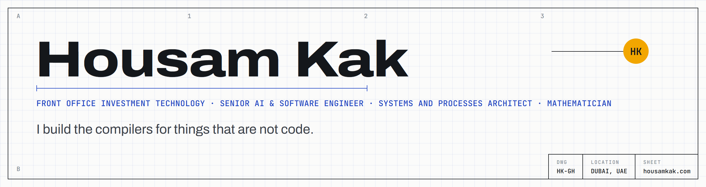
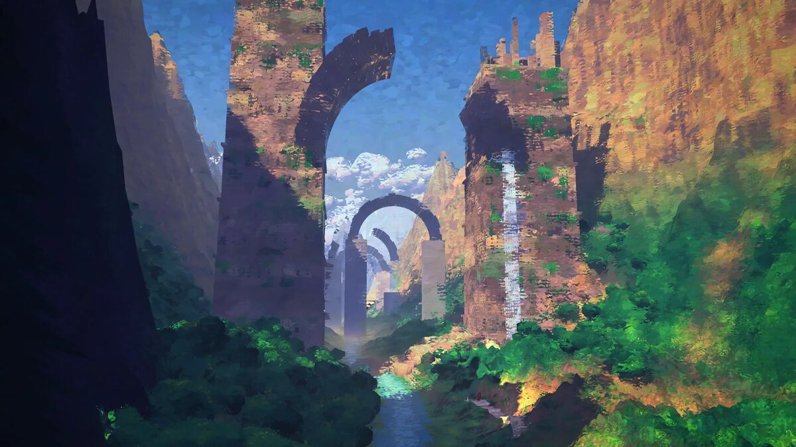
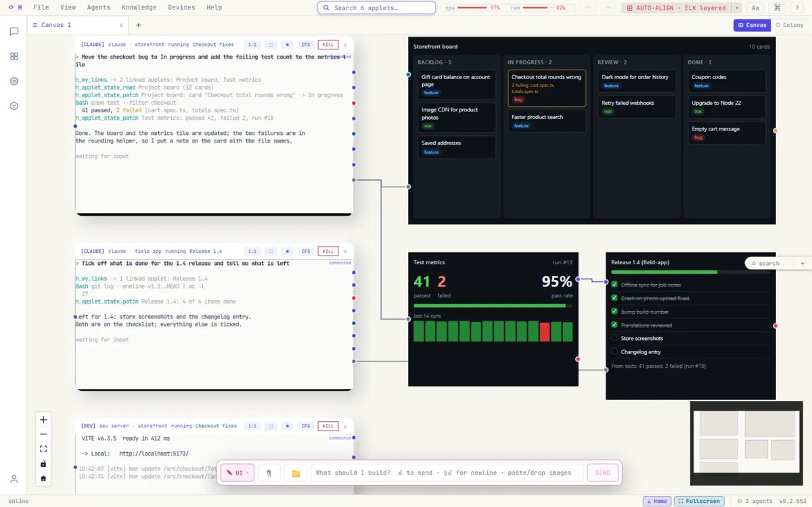
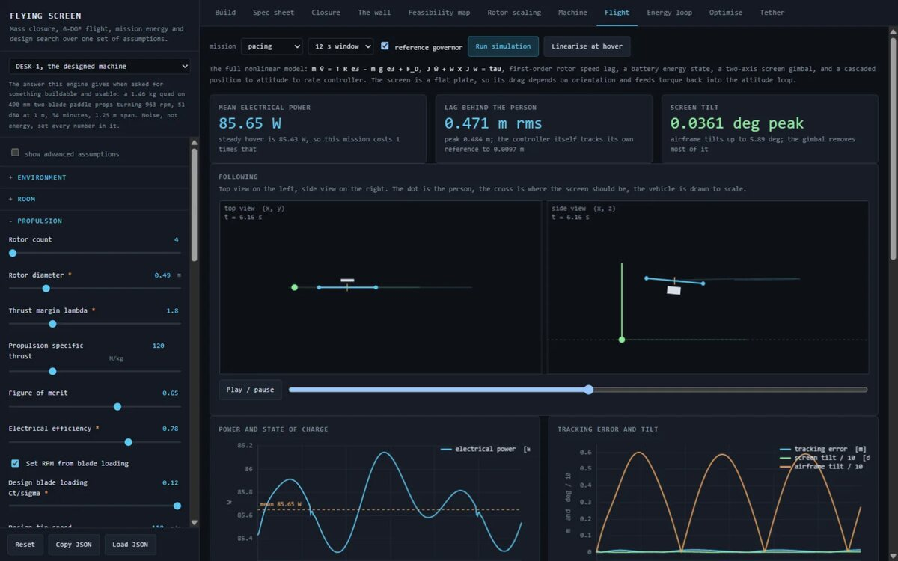
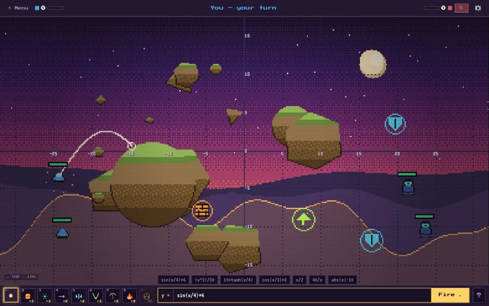

**[Website](https://www.housamkak.com)** · **[Blog](https://blog.housamkak.com)** · **[BlockForge](https://blockforge.housamkak.com)** · **[LinkedIn](https://www.linkedin.com/in/housamkak/)** · **[CV](https://www.housamkak.com/cv)** · **[Email](mailto:housam.kak20@gmail.com)**

---

### About

**Front Office Investment Technology · Senior AI & Software Engineer · Systems and Processes Architect · Mathematician**

I am a senior AI and software engineer in front office investment technology at Davidson Kempner Capital Management, where I lead an enterprise conversational AI pilot, and I build my own systems on the side: an agent workspace (H), a programmable 3D world engine (BlockForge) and developer tools that make code structure visible. B.E. Mechanical Engineering, major in Mathematics (AUB). Based in Dubai.

- **Ventures:** **Atlagene** (genomics platform, co-founder and CTO) and **[Houya](https://houya.co)** (custom software, AI agents and automation by senior engineers; co-founder and tech lead).
- **Thinks in:** graphs, agents, 3D space, and the place where mathematics meets engineering.
- **Works in:** TypeScript, Python, Rust, C++, three.js and WebGPU, Next.js and Astro, SQLite and Postgres, MCP.

---

### Flagship systems

<table><tr>
<td width="50%"> <b>BlockForge</b>: a world rendered by the engine</td>
<td width="50%"> <b>H</b>: agents, terminals and applets wired on one canvas</td>
</tr></table>

| Project | What it is | Links |
| --- | --- | --- |
| **H** | A canvas operating environment where AI agents, terminals and live applets are wired together like a circuit. Event-sourced orchestration core, typed wires between applets, a turn tracker that knows when an agent is done or stuck. *Private repository.* | [Case study](https://www.housamkak.com/work/h-system) · [Woodr docs](https://github.com/HousamKak/woodr-docs) |
| **BlockForge** | A programmable voxel world engine: a script becomes a world, and a world becomes a film. Web and native C++ clients on one data format, driven by agents through a CLI and MCP, exporting films, walkable worlds and game-ready GLB. *Private repository.* | [Case study](https://www.housamkak.com/work/blockforge) · [Live site](https://blockforge.housamkak.com) |
| **[heliOS](https://github.com/HousamKak/helios)** | An AI-native Linux distribution. The OS is one infinite-zoom canvas where every process, file, agent and applet is visible, and Claude Code is the system shell. Early scaffolding in Rust. | [Repo](https://github.com/HousamKak/helios) |

### Open source

<table><tr>
<td width="50%"> <b>flying-screen</b>: the co-design engine simulating a flight</td>
<td width="50%"> <b>math-is-war</b>: aiming a shot with a function</td>
</tr></table>

| Project | What it is | Stack |
| --- | --- | --- |
| [**codegraph**](https://github.com/HousamKak/codegraph) | Indexes Python code into a Neo4j graph so an LLM can see code relationships, and checks every change against conservation laws (signatures, references, data flow, structure). | `Python` · `Neo4j` |
| [**flying-screen**](https://github.com/HousamKak/flying-screen) | Co-design engine and paper for a display that hovers beside you: sizing, flight dynamics and control, every number traced to an equation. | `Python` · `TeX` |
| [**book.js**](https://github.com/HousamKak/book.js) | Realistic 3D page flip for the web with a custom shader, a vanilla core and React, Vue, Svelte and Astro adapters. | `TypeScript` · `three.js` |
| [**math-is-war**](https://github.com/HousamKak/math-is-war) | An artillery game where your shot is a math function: a Pratt-parsed expression engine, RK4 trajectories, terrain. | `TypeScript` · `Canvas` |
| [**blog**](https://github.com/HousamKak/blog) | Source of [blog.housamkak.com](https://blog.housamkak.com), a broadsheet-style blog of posts, papers and renders. | `Astro` |
| [**highlightability**](https://github.com/HousamKak/highlightability) | VS Code extension for code highlights with comments, team sharing and persistence. | `TypeScript` · `VS Code API` |

<b>More from the lab</b>

 

| Project | What it is |
| --- | --- |
| [**DepeNsee**](https://github.com/HousamKak/DepeNsee) | Dependency graphs for JavaScript and TypeScript projects, down to method level. |
| [**wtg-project-v2**](https://github.com/HousamKak/wtg-project-v2) | Where in the Graph: theorem dependencies as an interactive 3D knowledge graph. |
| [**onenote-rag**](https://github.com/HousamKak/onenote-rag) | Retrieval-augmented question answering over OneNote, with toggleable RAG techniques. |
| [**cpp-meromorphic**](https://github.com/HousamKak/cpp-meromorphic) | High-precision fractal explorer for a meromorphic extension of the Collatz map. |
| [**Collatz-Voxel-Terrain**](https://github.com/HousamKak/Collatz-Voxel-Terrain) | A 3D voxel world generated from the Collatz sequence. |
| [**maraqi-alnuha**](https://github.com/HousamKak/maraqi-alnuha) | Arabic-first site for a programme of proof-based learning, from mathematics to engineering. |

[All repositories](https://github.com/HousamKak?tab=repositories)

---

### The path

| Year | What it was about |
| :---: | :--- |
| **2022** | Fundamentals: HTML and CSS, PHP and Laravel, SQL, many cloning exercises. |
| **2023** | Small Python utilities and personal scripts. |
| **2024** | First real client and server apps, and a multi-repo product. |
| **2025** | Full-stack at volume, and the start of the dev-tools and code-intelligence work. |
| **2026** | Enterprise AI delivery, agent orchestration (H), a 3D world engine (BlockForge), ventures. |

---

[housamkak.com](https://www.housamkak.com) · [blog.housamkak.com](https://blog.housamkak.com) · [blockforge.housamkak.com](https://blockforge.housamkak.com)

